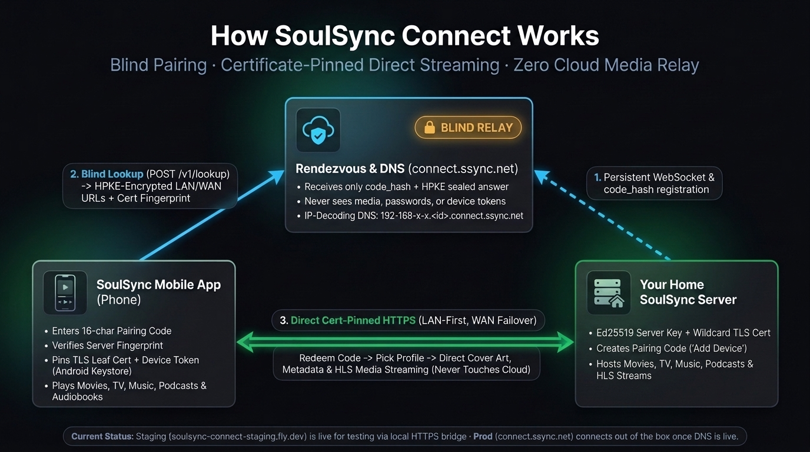

# SoulSync Mobile App (`soulsync-mobile-app`)

Native mobile and TV client for **SoulSync** — a full **1:1 port of SoulSync `/player`** paired securely to your home server via **SoulSync Connect** (`DESIGN-CONNECT v0`, Nov 21, 2026 Option B).

Stream **Movies, TV Shows, YouTube, Music, Podcasts, Audiobooks, and Live Guide** straight from your home SoulSync server with zero cloud media relay.

---

## How SoulSync Connect Works



1. **Your SoulSync server connects out:** SoulSync holds open a lightweight outbound WebSocket to `connect.ssync.net` — no port forwarding is required for pairing.
2. **Generate a pairing code:** In SoulSync, open **Settings → Devices → Add a device**. SoulSync generates a one-time 16-character pairing code and registers only its `SHA-256` hash (`code_hash`) with the blind relay.
3. **Enter the code in the app:** The app sends `code_hash` + an ephemeral X25519 public key (`POST /v1/lookup`). Your home server replies with an **RFC 9180 HPKE-encrypted** envelope containing its LAN/WAN addresses and TLS certificate fingerprint. The relay cannot read inside it.
4. **Verify fingerprint & pick a profile:** You confirm the 12-character server fingerprint shown on both screens once, pick your SoulSync profile, and the app pins your server's leaf TLS certificate + device token in **Android Keystore (`AES-256-GCM`)**.
5. **100% direct streaming:** From that point on, all browsing, cover art, metadata, and HLS/direct media streaming go **directly between your phone and your home SoulSync server** (LAN-first with automatic WAN failover). A `connect.ssync.net` outage never interrupts playback.

---

## Features (1:1 SoulSync `/player`)

- **Premier Ink-Glass UI:** Full-bleed hero carousel, Netflix-style cover rails, Top 10 ranked badges, glassmorphic navigation (adaptive left sidebar on tablets/landscape/TV, bottom nav on phones), and official SoulSync branding.
- **Customizable Home Dashboard:** Show/hide, reorder, and sync your Home rails directly with SoulSync's web `/player` shared layout.
- **Movies & TV Shows:** Library browse, detail sheets, seasons & episodes, cast & crew (`Person Detail`), personal Notes, Extras, Watchlist, Watching Now, and full-screen HLS/direct `ExoPlayer` with seek & progress sync.
- **Music & Discover:** Artists, Albums, Tracks, Playlists, Discover mixes, and a full **Audio Now Playing** sheet with synced Lyrics, Queue management, and playback speed.
- **YouTube, Podcasts & Audiobooks:** Full library browsing, episode/chapter playback, watchlist management, and resume progress.
- **Live Guide (EPG):** Channel lineup, now-playing schedule, reminders, and favorites.
- **Android TV / D-Pad Ready:** Focusable cards and Leanback-compatible manifest.

---

## Repository Layout

- [`android/`](android/) — Native Android & Android TV client (Kotlin, Jetpack Compose, Material 3, AndroidX Media3 `ExoPlayer` + `MediaSessionService`, `minSdk = 26`, `compileSdk = 35`).
- [`ios/`](ios/) — Placeholder for the future native Swift/SwiftUI iOS client built against the same Connect protocol and conformance vectors.
- [`spec/`](spec/) — Shared SoulSync Connect protocol reference and `conformance-vectors.json`.
- [`docs/`](docs/) — Architecture diagrams and documentation.

---

## Android Module Structure

| Module | Type | Responsibility |
| :--- | :--- | :--- |
| `:core:connect` | Pure Kotlin/JVM | `PairingCode`, `ServerIdentity`, `IpLabelCodec`, RFC 9180 Base Mode `RawRfc9180Hpke`, Option B `RendezvousAnswerVerifier`, `RendezvousClient`, 100% `ConformanceVectorsTest` |
| `:core:storage` | Android Library | `PairedServerRecord` + `KeystoreServerVault` (`AndroidKeyStore` AES-256-GCM encrypted atomic file) |
| `:core:network` | Android Library | `CertPinningOkHttp` (leaf cert SHA-256 pin + Bearer token), `CandidateAddressRacer` (LAN-first), `AdmitClient` (`app = "player"`) |
| `:core:player` | Android Library | `PlayerApiClient`, `MusicApiClient`, `PlayerArtwork`, `PlayerModels`, `SoulSyncPlaybackService` (Media3 `ExoPlayer` + HLS + cert-pinned `OkHttpDataSource`) |
| `:feature:pairing` | Android Library | SoulSync ink-glass theme, pairing code flow, 12-char fingerprint verify card, profile picker, `DpadFocusable` |
| `:app` | Android App | `staging` & `prod` flavors, `PlayerShell`, `HomeScreen` + `HomeEditorSheet`, `MoviesAndTvScreens`, `MusicScreens`, `YouTubePodcastAudiobookScreens`, `GuideWatchlistWatchingScreens`, `VideoPlayerOverlay`, `AudioNowPlayingSheet` |

---

## Security & Architectural Boundaries

- **Zero cloud playback dependency:** All media, artwork, and API calls after pairing go directly to the user's SoulSync server over certificate-pinned HTTPS.
- **No MetaSync / SIN calls:** This repository never calls `metasync.ssync.net`, SIN, or bundles any server-side code.
- **Zero raw code leakage:** Raw pairing codes travel only `user → app` and `app → SoulSync` over the direct cert-pinned channel. `connect.ssync.net` sees only `code_hash` and an ephemeral public key.
- **Playback-only device scope:** Paired apps receive a `KIND_PLAYER` device token scoped strictly to playback, browse, and artwork endpoints — never admin settings, downloads, or user management.
- **Secret hygiene:** `lookup_id`, raw pairing codes, and `device_token` are redacted from logs/`toString()` and encrypted at rest in Android Keystore.

---

## Build & Test (Android)

Requires **JDK 17** and **Android SDK (API 35)**.

```bash
cd android

# Run pure-JVM Connect crypto & conformance vector tests
./gradlew :core:connect:test

# Run all unit tests
./gradlew testDebugUnitTest

# Build APKs
./gradlew :app:assembleStagingDebug   # targets https://soulsync-connect-staging.fly.dev
./gradlew :app:assembleProdDebug      # targets https://connect.ssync.net
```

### Build Flavors
- **`prod`** (`connect.ssync.net`) — Default flavor for production SoulSync servers once `connect.ssync.net` DNS is live.
- **`staging`** (`soulsync-connect-staging.fly.dev`) — Staging flavor for end-to-end testing against Muse's staging rendezvous service.
